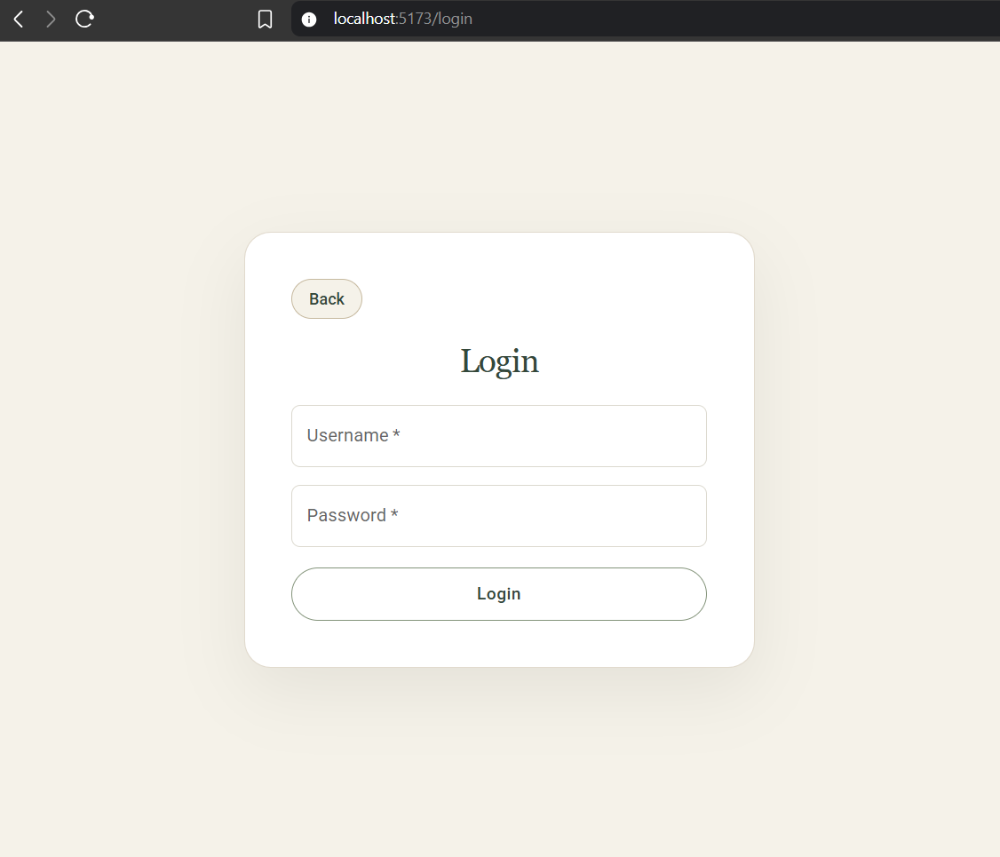
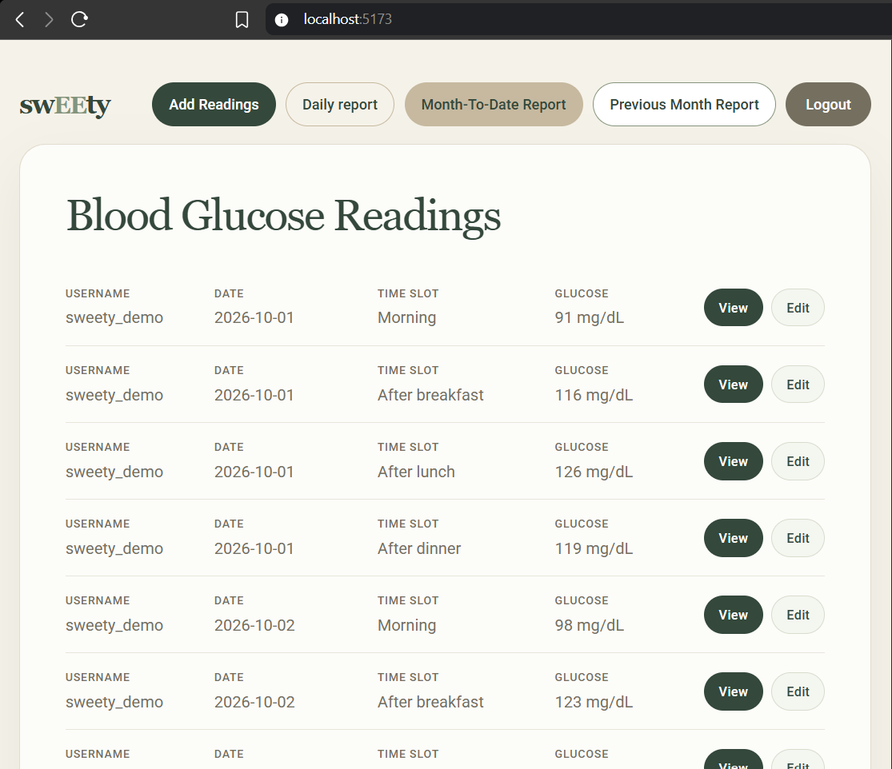
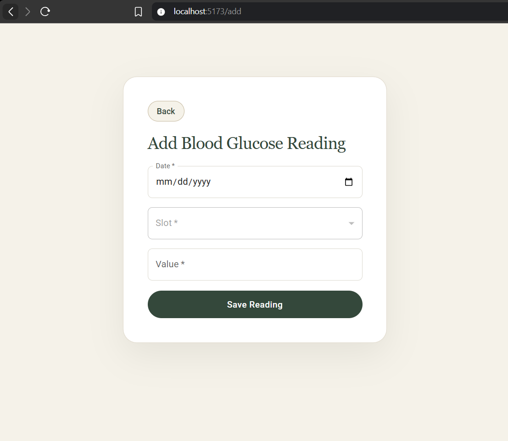
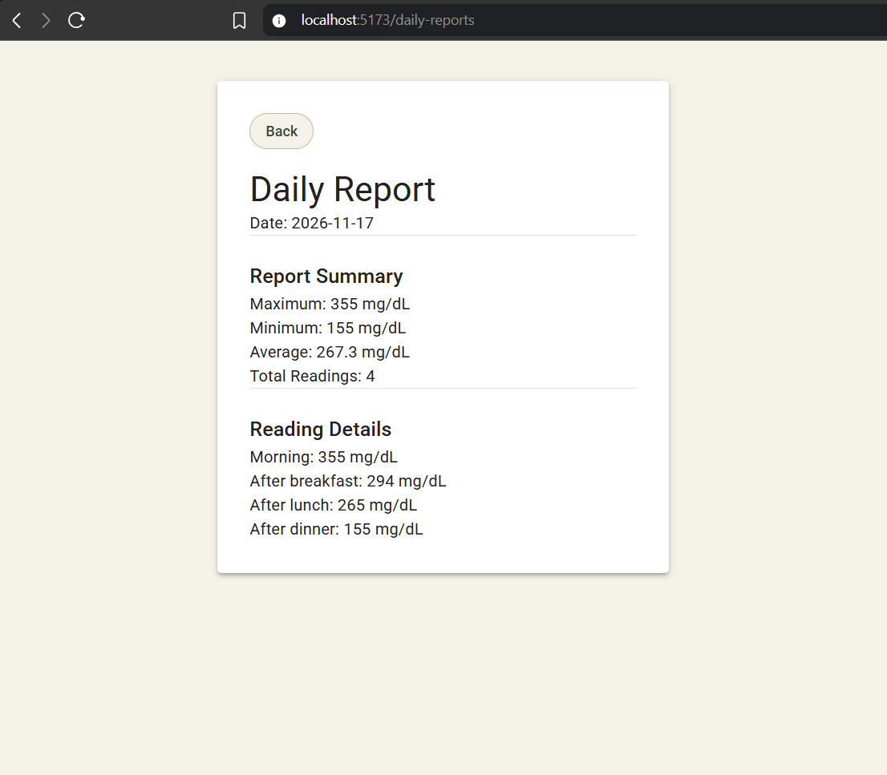
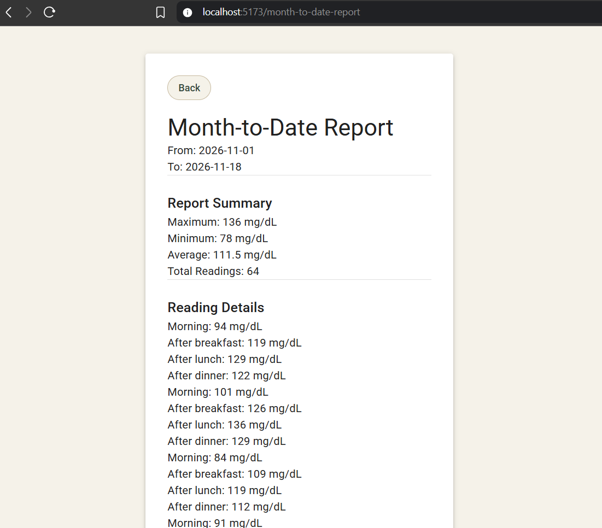
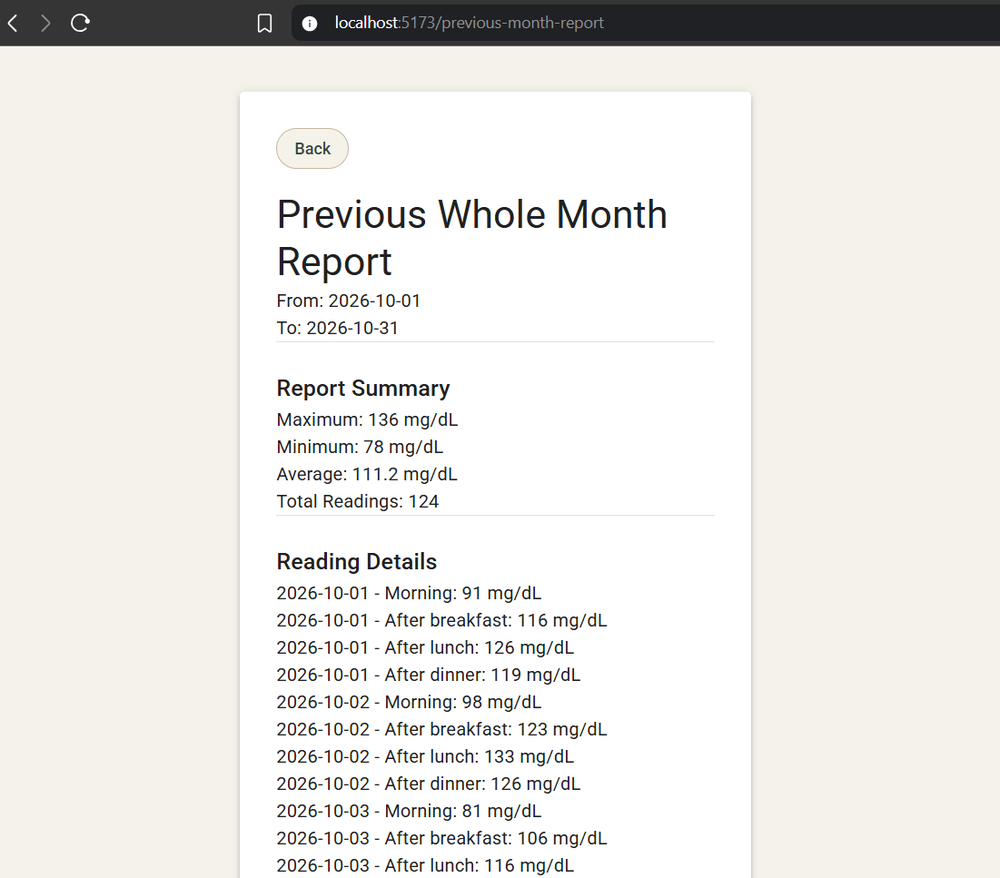

# Sweety – Blood Glucose Tracker

## 1. Project Overview

Sweety helps users record and review their blood glucose readings. The app uses a React frontend, an Express backend, and MongoDB.

## 2. Features

- Create an account, log in, and log out.
- Add, view, edit, and delete readings.
- Record four daily slots: Morning, After breakfast, After lunch, and After dinner.
- View Daily, Month-to-Date, and Previous Month reports.

## 3. Technologies Used

- React, Vite, React Router, and Material UI.
- Node.js and Express.
- MongoDB and Mongoose.
- Passport Local, `passport-local-mongoose`, `express-session`, and `dotenv`.

Passwords are handled by `passport-local-mongoose`; this project does not use bcrypt directly.

## 4. Prerequisites

- Node.js and npm.
- MongoDB running locally, or a MongoDB connection URI.

## 5. Installation

Open a terminal in the project folder and install both apps' dependencies:

```powershell
cd backend
npm install
cd ..\frontend
npm install
```

## 6. Environment Setup

In the `backend` folder, create your local environment file:

```powershell
Copy-Item .env.example .env
```

Set the values in `backend/.env`. The example uses local MongoDB:

- `MONGODB_URI` — database connection.
- `SESSION_SECRET` — a long, private session key.
- `PORT` — backend port (default: `3000`).
- `DEMO_USERNAME`, `DEMO_EMAIL`, `DEMO_PASSWORD` — local demo account details.

Keep `.env` private; do not commit it.

## 7. Run the Project

Start MongoDB first. Then run the backend in one terminal:

```powershell
cd backend
node index.js
```

Run the frontend in a second terminal:

```powershell
cd frontend
npm run dev
```

Open the local address shown by Vite, usually `http://localhost:5173`.

## 8. Demo Account

Use these local demo credentials after running the seed command:

- Username: `sweety_demo`
- Email: `sweety.demo@example.com`
- Password: `SweetyDemo2026!`

The seed script reads the demo account values from `backend/.env`.

## 9. Seed Sample Data

With MongoDB running and `backend/.env` set, run:

```powershell
cd backend
npm run seed
```

This creates or reuses the demo account and fills readings for last month's full calendar and this month through yesterday. Existing readings are skipped if you run it again.

## 10. Screenshots

### Login Page



### Home Page



### Add Reading



### Daily Report



### Month-to-Date Report



### Previous Month Report



## 11. Notes

- Sample dates follow the `Asia/Kolkata` calendar.
- Backend automated tests are not configured yet. The backend `npm test` command is a placeholder. Frontend checks are `npm run lint` and `npm run build` (run from `frontend`).
- With more time, add automated backend tests and include screenshots of the running app.
